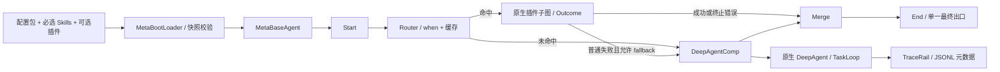
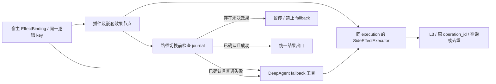
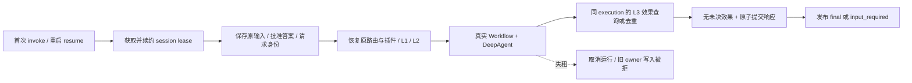
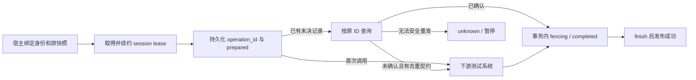
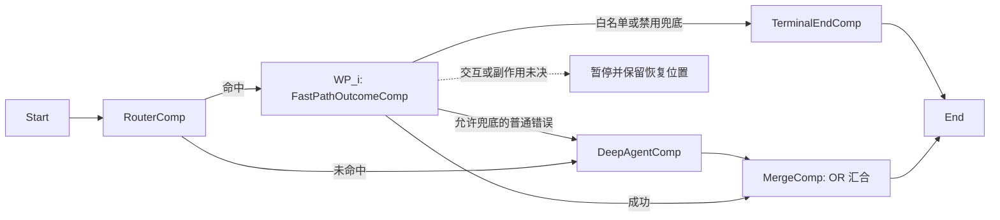

# MetaAgent 架构设计文档

**2026-11-04 结构化业务结果增补**：统一结果出口只统一执行状态和错误处理，不要求业务结果为文字。插件通过可选的 `PluginOutcome.data` 返回业务自定义的 JSON 数据，经 Merge / End 保留到 `AgentResult.data`；`output` 继续作为文字说明。普通调用、流式最终事件、HTTP/A2A 和已完成响应恢复均传递该字段。失败且允许回退时，插件数据作为带来源的上下文交给 DeepAgent，不自动成为最终成功结果。默认 data=null，兼容旧插件。详见 [ADR-0003](docs/adr/0003-m3-fastpath-contract.md) 和 [返回接口示例](README.md#快路径与退款样例)。

**2026-10-22 成员审批恢复增补**：PostgreSQL 已接通 native Team DB、A2A tasks 与 native 文件快照。本批支持未完成成员停在工具审批点：先恢复原成员 execution/tool call ID，再由 Leader approve_tool 批准或拒绝。A2A 交接保留原 task 与累计 usage，不重复委派；停止交互不视为审批答案。业务包/配置路径须一致，成员普通 ask_user、其他写入组合及实际跨主机部署仍待完成。 固定口径仍为 **13/20 ≈ 65%**，#10 待补部署证据。见 [团队 worker](examples/team_worker/README.md)与 [PLAN](PLAN.md)。

| 项目 | 内容 |
|---|---|
| 文档版本 | V1.1（2026-10-20 修订；2026-10-22 未完成成员工具审批接续增补） |
| 状态 | 双路径、本地恢复与配置成员团队已有实现；团队 A2A/AgentGov 本地链路及 worker 审批重启恢复已接通，单 Agent 与 Team/A2A PostgreSQL 审批交接已接通，未完成成员工具审批接续已实现，真实跨主机/平台待完成 |
| 上游依赖 | OpenJiuwen agent-core（`openjiuwen` 包，harness / core / agent_teams / agent_evolving / extensions） |
| 关联文档 | [MetaAgent 系统设计文档 V1.1](MetaAgent-系统设计文档.md)；[历史提案](MetaAgent-design.md)不再作为实现依据 |
| 代码依据 | `../openjiuwen-latest/agent-core`，`develop@4cd9df83855c0504af314655fbd7e2f34a0442fa`；以此提交的源码符号为准，不沿用旧副本行号 |

本轮修订范围：插件后置 fallback、MetaAgent 配置装配边界、AgentTeams 扩展点、L3 操作身份与耐久提交、session 租约和 A2A 边界。本文同时记录目标契约与分批实现；以下日期标记说明已验证范围，完整验收以 PLAN 和系统设计 §4.7 的门禁为准。

2026-10-21 的 [M1 验证记录](docs/compatibility/m1-validation.md) 给出真实内核组合、成员 provider/runtime 和本机进程终止的证据。已验证的接缝可以用于后续实现；完整 MetaAgentSpec、预算执行、Leader/单成员生命周期、平台 MCP/权限和分布式恢复不能由这些局部结果外推。具体决策见 [ADR-0001](docs/adr/0001-m1-integration-boundaries.md)。

**M2/M3 实现状态（2026-10-21）**：`src/meta_agent` 已落地受限的完整 native spec 包装、配置包加载、MetaBaseAgent、无插件三节点图及有插件双路径图。M2 的增量流、输入续跑、活动 follow-up 和取消之外，M3 增加版本化插件快照、路由、后置 fallback 与统一出口。当前仍为独立单 Agent 开发形态；完整团队、平台和生产恢复留在后续阶段。证据见 [M2 记录](docs/compatibility/m2-validation.md)、[M3 记录](docs/compatibility/m3-validation.md)，决策见 [ADR-0002](docs/adr/0002-m2-local-runtime.md)、[ADR-0003](docs/adr/0003-m3-fastpath-contract.md)。

无插件时仍为 Start → DeepAgentComp → End。有插件时当前可运行路径如下；成功快路径不会调度 DeepAgent：



路由依次使用 Skill exact/prefix、regex、可选 embedding、独立 when、可选 classifier；所有候选都受 when 约束。缓存包含调用方 context、scope 与配置/插件版本，命中时重验 when。可编程模型边界已验证，真实分类模型和时延目标尚未验收；权限 context  由可信宿主提供。

插件通过 PluginWorkflow 记录公开构图操作并校验，FastPathOutcomeComp 保持原生 SubWorkflowComponent 中断/续跑语义。成功或白名单终止经 Merge；显式普通失败返回后才决定 fallback，并携带来源、partial 和 completed_operations。控制异常及其 cause/context 链继续传播。退款内存账本样例证明成功路径为 0 次 DeepAgent/模型调用，但不构成耐久副作用保证。

原生 SkillUseRail 默认会附带系统工具；通过公开配置禁用这些工具，保留原生 `skill_tool` 的技能读取。自定义 tools/rails/plugins 是受信任业务代码。预算、子代理、MCP/CSP、团队、进化、分布式及外部 effects 开关明确拒绝开启；SQLite checkpoint 选择不等于冷恢复或 L3 journal 已完成。

**M4 首批状态**：独立的 `DurableExecution` / `SideEffectExecutor` 已接入本地 SQLite WAL/FULL journal、自动续约 lease、事务内 fencing 和制品 pin。相同逻辑 key 重试复用已持久化的 operation_id；未知结果先查询，只有下游去重契约允许重发。未知效果阻止新操作和完成；独立测试账本在真实进程终止后仍只产生一次效果。原生工具与子图可以通过显式适配器使用此 API，现可用 LocalRecovery 自动装配 MetaBaseAgent execution、原生 L1/L2 和响应发布门禁；全部写入面与共享存储仍待验收，完整 M4 继续开放。[本地证据](docs/compatibility/m4-local-effects-validation.md) · [ADR-0004](docs/adr/0004-local-durable-effects.md)。

**M4 本机运行时恢复**：宿主显式启用 LocalRecovery 后，admission、原 query/context、route、checkpoint 和终态响应与 L3 共用事务内 fencing。resume 重建原 graph/plugin/child identity；已完成响应直接读取，未决效果先对账。L1 保存原生错误/交互位置，L2 与 child outcome 原子提交；未提交计算允许重做，效果通过原 operation_id 防重。stream 缓冲终态，关闭保留状态。详见 [ADR-0005](docs/adr/0005-local-runtime-recovery.md)。

**M4 快路径写入恢复（2026-10-22）**：宿主 EffectBinding 将插件能力名、适配器版本和逻辑操作 key 固定到配置指纹。manifest 声明 effects 后才能通过 context.effect 构造受管节点，嵌套子图一同校验；fallback 工具使用同一绑定，因此不会为已完成退款分配另一操作 ID。路径切换前检查 journal，未决效果禁止转 DeepAgent；完成操作和回执从 journal 提供，不信任插件自报列表。成功快路径仍为零 DeepAgent 调度。证据见 [本批记录](docs/compatibility/m4-fastpath-recovery-validation.md)，契约见 [ADR-0006](docs/adr/0006-fastpath-effect-bindings.md)。








此图表示独立 Effect API 的本地外部效果边界；整个 Agent 的原生 L1/L2 装配由上述 LocalRecovery 提供。元数据/制品 pin 本身不等于完整 Agent 恢复；本地多进程 SQLite 验证不能外推到跨主机共享存储。

---

## 1. 目的

本文档定义基于 OpenJiuwen agent-core 构建的通用 Agent 底座 **MetaAgent** 的架构。MetaAgent 面向平台（CSP 云平台）发布、产品开箱接入，目标是：

1. **一个底座，两类业务开发范式**：业务方要么开发 *skills + agent 配置*（harness 配置包，插入深度主路径），要么开发 *workflow 插件包*（快路径）；两种包放固定路径、拉起即加载，无需改动 MetaAgent 本身；
2. **时延与精度的平衡**：确定性、高频、流程固定的请求走 workflow 快路径（毫秒级路由、DAG 直出）；开放域、长视界、复杂规划请求走 DeepAgent harness 深度 Loop（主路径）；两条路径由 FastPathRouter 两级路由串联为一张统一 DAG；
3. **单 Agent 与多 Agent 的统一**：MetaBaseAgent（单 Agent 底座）之上由 MetaAgentTeam 编排（集成 OpenJiuwen AgentTeams），产品可用一份默认配置跑单 Agent，也可用多 Agent 编排配置构建团队；
4. **生产级可信**：恢复到最近一次耐久提交的计算状态（checkpoint 体系）、可度量的轨迹采集、与平台推理/记忆/MCP/Skills 运行时的标准对接、双形态部署（组件嵌入产品容器 / 独立 agentworker 容器）。

## 2. 范围

### 2.1 范围内（In Scope）

| # | 范围项 | 说明 |
|---|---|---|
| 1 | MetaBaseAgent 运行时 | FastPathRouter、快路径 workflow 插件执行、Harness 主路径（DeepAgent TaskLoop + ReAct Loop）、统一 DAG 编排（MetaOrchestrator）、fallback 语义 |
| 2 | MetaAgentTeam 编排层 | 基于 `openjiuwen.agent_teams` 的多 MetaBaseAgent 协同；默认单成员配置由平台提供 |
| 3 | 插件体系 | skills + agent 配置包（必选）、workflow 插件包（可选）的目录约定、manifest、加载/热更新/卸载、版本管理 |
| 4 | 平台适配层（CSP Adapter） | 推理调度（inferschedule REST）、上下文记忆服务（可选）、MCP 服务（必选通道）、Skills 运行时（可选独立进程）、告警运维 |
| 5 | 状态与恢复 | 三层 checkpoint 体系（会话/图状态、任务循环状态、幂等副作用日志），进程崩溃/实例漂移/升级/中断四类场景的恢复 |
| 6 | 可观测与进化 | OTEL tracing、TraceSchema 流、自进化轨迹打点（`TrajectorySpanProcessor` + JSONL 轨迹文件）、Skill 进化闭环与快路径供给 |
| 7 | 部署与交付 | 组件模式与镜像模式两种发布形态；启动加载流程；未来界面上传更新的演进规划 |
| 8 | 服务化接入 | MetaAgent **遵守 A2A 协议标准**；A2A 服务端由平台 **AgentGov 服务**统一提供（集成 OpenJiuwen 仓库自带 A2A Server）；平台提供 **MateMind SDK（C++/Python/Rust）**经 A2A 接口访问 MetaAgent；组件模式下产品侧 in-process SDK 直连 |
| 9 | AgentGov 对接 | MetaAgent 实例启动时向 AgentGov 注册（AgentCard + 实例信息 + 心跳），AgentGov 依托云平台持有全部 Agent 的注册与实例信息，对外提供统一 A2A 接入面并路由到实例 |

### 2.2 范围外（Out of Scope）

- OpenJiuwen core 本身的修改（以源码为准，不改上游；缺口以 MetaAgent 侧扩展补齐）；
- 平台 Studio / Ops 界面的具体实现（仅定义 MetaAgent 暴露给界面的管理接口契约）；
- **AgentGov 服务本身的建设**（注册中心、A2A 接入面、路由与治理界面由云平台团队负责），本文档只定义 MetaAgent 与 AgentGov 的对接契约（注册/心跳/路由语义）；
- **MateMind SDK 的完整实现**（本文档只定义其三语言统一语义与 A2A 调用契约）；
- RL 训练与离线进化管线（`openjiuwen.agent_evolving` 的训练侧不在本期，仅消费其 trajectory/经验存储接口）；
- 业务 workflow 插件的内部实现（仅定义 Executable 契约与 manifest 规范）。

## 3. 架构和关键质量要求

### 3.1 架构目标（Architecture Goals）

| 编号 | 目标 | 度量 |
|---|---|---|
| G1 | **开箱即用** | 产品放置业务包到固定路径 → 配置路径 → 拉起即服务；零代码接入主路径；快路径仅一个 workflow 构图函数 |
| G2 | **低时延** | 快路径命中场景端到端时延目标 P95 ≤ 2s（含路由）；路由本身 P95 ≤ 50ms（规则/embedding 降级路由），LLM 意图路由 P95 ≤ 300ms |
| G3 | **高成功率的复杂任务** | 主路径复用 DeepAgent TaskLoop 原生成功率；fallback 语义保证快路径异常时正确性不退化 |
| G4 | **已提交状态可恢复** | 在明确的持久化后端、保留期及版本兼容条件下恢复最近一次提交的会话/图/迭代/路由状态；副作用仅在下游去重或查询契约成立时自动恢复，未决操作暂停对账 |
| G5 | **插件化定制** | skills/rails/workflow 插件/路由策略（演进）四类扩展点；热加载、原子切换、可精确卸载 |
| G6 | **多 Agent 协同** | 目标：单配置扩展到 N 个 MetaBaseAgent；权限/HITT/tracing 与 Leader/单成员接线通过 GATE-TEAM 后才能验收为可用 |
| G7 | **可观测可进化** | 全链路 trace（OTEL + TraceSchema）、JSONL 采集及丢失/刷盘失败指标、进化闭环可审批可回滚；默认异步缓冲允许崩溃时丢失未刷盘事件，零丢失需求须另启耐久队列 |

### 3.2 关键架构需求（Key Architecture Requirements）

| 编号 | 需求 | 优先级 | 说明 |
|---|---|---|---|
| KAR-1 | 快路径与主路径必须编译进**同一张 DAG**，条件边调度，命中时主路径节点零调度 | 高 | 用 `openjiuwen.core.workflow.Workflow` 的 `add_conditional_connection` 实现 |
| KAR-2 | 路由判定必须支持**免 LLM 降级**（规则/embedding），并保留 LLM 意图路由作为精度上限 | 高 | 三层匹配：Skill 元数据 → 意图分类 → 插件声明式条件 |
| KAR-3 | 快路径插件执行失败必须可配置回退主路径，且**中间结果随 session 传递**，不重复劳动 | 高 | fallback 边 + session 全局状态沉淀 |
| KAR-4 | 业务包加载必须在**拉起时完成**（ skills+agent 配置包强制、workflow 包可选），且支持运行中热更新 | 高 | 启动扫描 + `load_plugin` 家族热加载 |
| KAR-5 | 所有 MCP 工具调用必须经平台 MCP 服务 | 高 | McpGatewayAdapter 统一收口 |
| KAR-6   | checkpoint 必须覆盖：workflow 图状态（`workflow-graph` 命名空间）、DeepAgentState（迭代级）、路由决策日志、工具副作用幂等日志 | 高 | 三层 checkpoint |
| KAR-7 | 自进化轨迹必须支持打点**到平台独立日志轨迹文件**（JSONL） | 高 | `FileTrajectoryStore` + 自研 `MetaTraceFileSink` |
| KAR-8 | 多 Agent 编排必须复用 `openjiuwen.agent_teams.TeamAgentSpec/TeamAgent`，不得自研编排内核 | 中 | MetaAgentTeam 负责配置与适配；MetaAgentHarnessProvider/成员运行时接线须验证，不能假定 TeamAgentSpec 原生支持 MetaBaseAgent |
| KAR-9 | MetaBaseAgent 不得重写 DeepAgent 执行循环； Rail 是主路径唯一行为注入点 | 高 | 与 DeepAgent `_hot_reconfigure` / rail 装配约定一致 |
| KAR-10 | 同 `(product_id, agent_id, session_id)` 不并发执行 | 高 | 本地锁 + 多副本必选的可续约租约、owner 校验、fencing；Redis checkpointer 本身不提供执行互斥 |
| KAR-11 | MetaAgent 对外访问必须遵守 **A2A 协议标准**；A2A 服务端集中由平台 **AgentGov** 提供，MetaAgent 只向 AgentGov 注册、不直接对外暴露 A2A 端口（组件模式 in-process 除外） | 高 | 接入面统一、实例治理与鉴权收口 |
| KAR-12 | 无插件包时退化为纯 Harness；插件普通执行错误默认兜底，白名单内直接结束 | 高 | 中断/取消/租约失效/副作用未决状态单独处理，不得作为普通错误触发主路径，见 §6.1 |

### 3.3 质量属性场景（QA Scenarios）

| 场景 | 刺激 | 响应要求 |
|---|---|---|
| 进程崩溃 | agentworker 容器被 kill -9 | 同 session/request 恢复最近耐久边界；可自动对账场景 RTO 目标 ≤ 60s，未决副作用暂停并通知，不计为无条件自动恢复 |
| 快路径插件异常 | 插件抛异常 / 返回失败 | 条件边转向 DeepAgentComp，中间 TRACE 结果经 session 传入主路径 |
| 路由误判 | θ 偏低，深任务误入快路径 | 插件声明 `fallback_to_harness` 兜底；θ 自适应下调命中率低的插件 |
| 模型服务抖动 | inferschedule 5xx | ModelAdapter 重试 + 熔断；TaskLoop 层 Rail 兜底；告警上报平台 |
| 热更新插件 | 业务上传新 workflow 插件版本 | 版本化加载 → 增量编译进 DAG → 原子切换 → 旧版本按 LoadRecord 精确卸载 |
| 升级回滚 | MetaAgent 镜像升级后恢复旧会话 | checkpoint 数据带 schema 版本，升级路径提供迁移器；不兼容版本拒绝恢复并告警 |

## 4. 架构原则

| # | 原则 | 含义与落地 |
|---|---|---|
| P1 | **复用优先，不重写内核** | DeepAgent 执行循环、Workflow 引擎、AgentTeams、Checkpointer、进化 Rail 全部直接复用；MetaAgent 只做编排扩展（Router/Registry/DAGCompiler/装配器） |
| P2 | **DAG 即契约** | 快路径、主路径、路由、fallback 全部编译进一张 `Workflow` 图；图结构可被 `draw()` 可视化导出，作为业务的产品界面 |
| P3 | **快路径先行、主路径兜底** | 串行两级路由（先快后慢，非竞速）；快路径失败即回退，正确性优先于时延 |
| P4 | **配置即交付物** | 业务交付物只有两类包：skills+agent 配置包（必选）、workflow 插件包（可选）；均通过声明式 manifest 描述 |
| P5 | **渐进式插件化** | 当前：skills/rails/workflow 插件可插拔；演进：FastPathRouter 策略本身插件化 |
| P6 | **状态是头等公民** | 任何执行路径上的决策（路由结果、迭代计数、停止条件、副作用）都必须可序列化、可恢复 |
| P7 | **平台能力可替换** | 推理/记忆/Skills 运行时均有平台实现与 jiuwen 默认实现两轨，按配置切换；MCP 为必选平台通道 |
| P8 | **同一 session 串行** | 以 session 为并发隔离与 checkpoint 键单元，杜绝同会话并发执行（框架硬约束） |

## 5. 系统用例

### 5.1 上下文视图（Context View）

```
                        ┌─────────────────────────── 平台（CSP 云平台） ───────────────────────────┐
                        │                                                                       │
 平台运维/产品运营 ──────┼──▶ 镜像仓库 / 组件仓库 ──▶ 发布 MetaAgent（组件 or agentworker 镜像）      │
        │               │                                                                       │
        ▼               │   ┌──────────── AgentGov 服务 ────────────────┐                        │
 界面上传/更新插件(演进) ─┼──▶ │ A2A 接入面（JSON-RPC；集成 OpenJiuwen     │                        │
                        │   │   仓库自带 A2A Server）                    │                        │
                        │   │ Agent 注册与实例中心（依托云平台服务发现，   │                        │
                        │   │   持有全部 Agent 的注册与实例信息）         │                        │
                        │   └───────────────▲──────────────────────────┘                        │
                        │   inferschedule 推理调度(REST)   上下文记忆服务(可选)   MCP 服务(必选)      │
                        │   Skills运行时(可选)   告警运维    日志轨迹采集(读轨迹文件)                 │
                        └──────────▲───────────────────────────────────────────┬────────────────┘
                                   │ adapter 对接 + 向 AgentGov 注册/心跳       │ 打点/告警/轨迹文件
┌─ 产品运行环境 ────────────────────┴──────────────────────────────────────────┐         │
│  产品应用/前端 ──A2A(JSON-RPC)──▶ AgentGov ──按注册表路由──▶ MetaAgent 实例     │         │
│      │（组件模式：in-process SDK = MateMind Python 的本地后端）                │         │
│  ┌───┴────────────────── MetaAgent ────────────────────────────┐             │         │
│  │ MetaAgentTeam（多 Agent 编排，默认 1 个成员）                  │             │         │
│  │  └ MetaBaseAgent × N                                         │             │         │
│  │     ├ FastPathRouter ──▶ workflow 插件（快路径，可选注入）      │             │         │
│  │     └ Harness 主路径（DeepAgent + skills + rails）             │             │         │
│  │  Registry / DAGCompiler / Checkpoint / TraceSink             │             │         │
│  └──────────────────────────────────────────────────────────────┘             │         │
│   ▲ MateMind SDK(C++/Python/Rust) 经 A2A 接口访问（AgentGov 接入面）             │         │
└─────────────────────────────────────────────────────────────────────────────────┘         │
                                                                                              ▼
                                                          平台日志轨迹文件（JSONL）/ OTEL Collector / 告警系统
```

**外部参与者**：
- **产品应用**：业务系统；镜像模式经 **AgentGov A2A 接入面**调用 MetaAgent（可用平台 **MateMind SDK**：C++/Python/Rust）；组件模式在产品进程内直接 SDK 调用；
- **AgentGov**：平台服务，A2A 服务端与 Agent 注册/实例中心；MetaAgent 启动注册、心跳续约，AgentGov 按注册表路由请求到实例；
- **产品/业务开发者**：产出 skills+agent 配置包、workflow 插件包；
- **平台**：发布 MetaAgent、提供 inferschedule/记忆/MCP/Skills 运行时、AgentGov、接收打点与告警；
- **终端用户**：经产品前端发起会话，可能被人机中断（INPUT_REQUIRED）打断后恢复。

### 5.2 系统用例（Use Cases）

| UC | 名称 | 参与者 | 主流程概述 | 架构关注点 |
|---|---|---|---|---|
| UC-01 | 业务接入主路径 Agent | 业务开发者 | 开发 skills+agent 配置包 → 放置固定路径 → 启动加载 → 请求经 DeepAgent TaskLoop 处理 | skills 扫描注册、rail 装配、DeepAgentState |
| UC-02 | 业务接入快路径 | 业务开发者 | 开发 workflow 插件包（manifest + 构图函数）→ 注册 → 命中时 DAG 直出 | Executable 契约、意图元数据、热加载 |
| UC-03 | 请求两级路由 | 终端用户/产品应用 | 请求进入（经 AgentGov A2A 路由到实例）→ FastPathRouter 三层匹配 → 命中走快路径 / 未命中走主路径 | 统一 DAG、条件边、θ 自适应 |
| UC-04 | 快路径失败兜底 | 系统 | 插件异常 → 白名单判定 → 白名单外 fallback 边转 DeepAgent（中间结果传递）；白名单内直接结束返回 | fallback 语义、白名单、session 状态沉淀 |
| UC-13 | Agent 注册与 A2A 路由 | MetaAgent/AgentGov/产品应用 | MetaAgent 启动注册 AgentCard+实例信息 → 心跳续约 → 产品经 AgentGov A2A 接入面访问，AgentGov 按注册表路由到实例 | AgentGov 契约、MateMind SDK |
| UC-05 | 多 Agent 团队协同 | 业务开发者/终端用户 | 多 MetaBaseAgent 编入 Team → Leader 分解/派工 → 成员执行 → 汇总 | TeamAgentSpec、权限审批、HITT |
| UC-06 | 会话中断与续跑 | 终端用户 | 组件 `session.interact()` 触发 INPUT_REQUIRED → 用户补充输入 → 同 session 恢复 | Checkpointer 中断语义 |
| UC-07 | 崩溃恢复 | 系统/运维 | 进程崩溃 → 重启 → cold_recover 恢复全部计算状态 | 三层 checkpoint、幂等日志 |
| UC-08 | 插件热更新 | 业务开发者/平台界面(演进) | 上传新插件版本 → 版本化加载 → 增量编译 → 原子切换 → 旧版卸载 | LoadRecord 账本、DAG 写锁 |
| UC-09 | Skill 进化 | 系统/业务运营 | 轨迹采集 → SkillEvolutionRail 检测 → evolutions.json → 审批(/evolve*) → 固化 | 轨迹打点、审批 Rail |
| UC-10 | 进化沉淀为快路径 | 业务运营 | 高频固化 skill → workflow 化为快路径插件 → 注册 | skills 进化反哺快路径供给 |
| UC-11 | 团队会话恢复 | 系统 | team lifecycle=persistent → warm/cold recover 恢复团队 | AgentTeams 恢复分支 |
| UC-12 | 观测与告警 | 平台运维 | trace/轨迹/指标 → OTEL Collector / 轨迹文件 → 告警运维 | 三通道可观测、OpsReporter |

## 6. 关键技术方案

### 6.1 双路径统一 DAG 编排（核心机制）

OpenJiuwen workflow 引擎使用 `openjiuwen.core.graph.Graph` 及仓内 `core/graph/pregel/` 执行实现。MetaOrchestrator 把全部执行单元编译为一张 `Workflow`：



- **条件边**：`add_conditional_connection("router", router_fn)`，`router_fn(session)` 读全局状态中的 `RouteDecision` 返回目标 comp_id；**快路径命中时 DeepAgentComp 根本不会被调度**——"不等 harness"由 DAG 调度语义保证；
- **fallback 边**：`WP_i` 是新建的 `FastPathOutcomeComp`，内部执行插件 Workflow，把成功或普通错误归一化后正常返回；它自己的唯一条件边选择 MergeComp / DeepAgentComp / TerminalEndComp。RouterComp 只有首次分派边，不能在插件运行前判断插件错误，也不能依赖未捕获异常后的边继续执行。
- **控制状态**：INPUT_REQUIRED 保留子图恢复位置并向调用方透传；取消、租约失效和副作用结果未决直接停止/暂停。只有明确允许继续的普通插件错误进入白名单判定。
- **流式**：主路径可流式直出；本期快路径输出先暂存至成功或 INPUT_REQUIRED 再发布，失败暂存内容仅作为带来源的上下文交给主路径，避免用户收到两段相互冲突的最终答案。可单独发布不承诺最终结果的进度事件；所有输出在统一出口转换，不依赖子图 End 自动穿透外层图。
- **防环约定**（硬约束）：快路径 workflow 内部只允许轻量节点（LLMComponent / ReActAgentComp / ToolComponent），**禁止嵌套 DeepAgentComp**；DeepAgent 工具可反向调用快路径（经 ToolComponent 注册的 workflow 工具）；嵌套深度由 `workflow_max_nesting_depth`（默认 5，(0,10]）兜底。

**快路径与主路径的两级存在性语义**（KAR-12，硬性约定）：
- **无插件包注入**（或 `fastpath.enabled=false`）：MetaAgent 退化为 `Start → DeepAgentComp → End`；不实例化 FastPathRouter，不注入 RouterComp。
- **有插件包注入**：在排除上述控制/未决状态后，插件普通异常/失败默认转 Harness；manifest 的 `fallback_whitelist` 命中时结束并透传错误，`fallback_to_harness:false` 关闭普通错误兜底。

### 6.2 FastPathRouter 快路径路由

请求进入后的第一步，三层匹配 + 自适应阈值：

1. **第一层：Skill 元数据匹配**（~100 token 常驻元数据，毫秒级）——命中某 skill 关联的固定流程且置信度高时直接路由；
2. **第二层：意图分类**——默认零 LLM 降级路由（规则正则 / embedding 相似度，θ 阈值可配），高精度模式用 `IntentDetectionComponent`（LLM 分类，输出 `classification_id/name/reason`）；
3. **第三层：插件声明式条件**——manifest 中的 `when`（声明式条件表达式）求值；
4. **自适应**：`RouteStats` 按插件统计命中率/失败率，命中率低于下限自动降权（提高其 θ 或直接摘除，转 Harness 兜底）；支持**快路径先行**模式（命中即返回，不等待任何后续节点；未来演进支持并发模式）；
5. **路由结果缓存**：缓存键包含 query、影响 `when` 的上下文版本、配置/插件集合版本及权限版本；同一操作恢复复用其持久化决策，新一轮请求重新校验条件与版本。不能只按 session 或 query 命中后跳过动态条件检查。

### 6.3 插件体系与 Registry

三类注册槽（MetaRegistry）：

| 槽位 | 内容 | 机制 |
|---|---|---|
| SkillSlot | skills 目录扫描/热加载/进化 | `SkillUtil.register_skills()` + `SkillManager`；进化走 SkillEvolutionRail |
| FastPathSlot | workflow 插件注册/意图索引/动态加载 | manifest 解析 → Executable 校验 → DAG 增量编译 → `Runner.resource_mgr.add_workflow()` |
| TeamSlot | 子代理/团队成员配置 | `DeepAgentSpec.subagents` / `TeamAgentSpec.predefined_members` |

插件 = **Python 包/目录 + MetaAgent 自有 manifest**：根 `manifest.json` 的 `packageType=plugin`、workflow entry、意图、fallback 和 effects 由 MetaRegistry 解析，不宣称与内核 harness plugin schema 可直接互换。内核能力插件仍走其 `load_plugin`/LoadRecord 路径；兼容旧格式需要显式转换器及测试。热更新按图/意图索引版本快照原子激活，卸载先检查持久化版本 pin。

包关系（产品视角，硬性规则）：
- **skills + agent 配置包：必选**（没有它 MetaBaseAgent 不启动）；
- **workflow 插件包：可选**（无启用插件时使用纯 Harness 图，不创建 Router）；
- **演进**：FastPathRouter 的匹配策略本身支持插件化加载（RouterStrategy SPI）。

### 6.4 Harness 主路径

复用 DeepAgent 原生全部能力，MetaAgent 不重写执行循环：
- 外层 TaskLoop（`enable_task_loop=True`：`LoopCoordinator` 停止判据 + `TaskLoopController`，`wait_round_completion(timeout=600s)`），内层 ReAct Loop；
- Rail 链（默认装配约定同 `factory.py`）：SecurityRail / ModelAnomalyDetectionRail / TaskPlanningRail / SkillUseRail / SubagentRail / ToolCallResilienceRail，外加 MetaAgent 扩展 **FastPathBridgeRail**（主路径内反向调用快路径的桥）；
- 子代理：`create_subagent` + `enable_async_subagent`（EventQueue 异步 task 化）、sticky KV cache 预热（`prefetch_sticky_subagent`，子 session id `{parent}_sub_{task_id}`）；
- 交互控制 `follow_up / steer / abort / switch_mode(plan/auto)` 原样上抛；
- 预算停止：`GoalStopConfig`（`GoalRecord(max_attempts, token_budget)`，三种停止策略）作为业务配置透出；
- 热更新：`_hot_reconfigure` / `_hot_reload_rails` / `load_plugin_ability`。

### 6.5 MetaAgentTeam 多 Agent 编排

**2026-10-22 团队服务入口已实现**：`meta_team.yaml` 装配单 Leader 或配置的多成员团队。A2A 新业务输入先进入 Team，再进入 Leader 的 MetaBaseAgent DAG；Leader 选择快路径或 DeepAgent 主路径，需要协作时由原生团队调用成员 DAG。每个 A2A context 保留一份团队，审批回答和取消作用于原运行。直接 MetaBaseAgent 组件入口继续保留。

**本批服务范围**：成员完成轮次通过 A2A artifact/SSE 回传，支持 Leader 审批、取消及任务查询。团队包启用 `--durable` 后，worker 在其他成员结束或等待原生工具审批、且 Leader 审批已完整持久化交接后返回 `input_required`；重启可使用原 taskId/contextId 和新 messageId 续跑，保留原 execution、成员结果和累计 usage，不重复已完成的委派。默认模式仍需同进程回答。成员逐 token 流、passive-human 服务入口及任意时刻崩溃接管未接通。运行见[团队 worker 样例](examples/team_worker/README.md)，下一步验证隔离部署交接见 [PLAN](PLAN.md)。

- **复用边界**：`TeamAgentSpec.agents` 接受内核 DeepAgentSpec；常规 Runner 入口传 `TeamAgentSpec` 或已激活的 team_name，不能把 build 后的 TeamAgent 当作默认入口参数。生命周期分派由 Runner 管理，不复制旧版“四分支”列表。
- **本次源码新增依据**：`harness_protocol.HarnessProtocol`、`harness_providers.register_harness_provider` / `openjiuwen.harness_providers` entry point，以及 `agent_teams.external.member_runtime.ExternalHarnessMemberRuntime` 为三方成员提供真实接线点；`ExternalCliAgentSpec.cli_agent` 可选择三方 provider。
- **MetaAgent 扩展**：新建 MetaAgentHarnessProvider 包装 MetaBaseAgent，并转换输入、流、交互、取消、checkpoint 和模型配置；不得把配置写入 system_prompt/extras 后假定 DAG 会被调用。`SubAgentSpec.factory_name` 只属于子代理工厂，不是 TeamAgent 成员工厂。
- **集成状态与剩余门禁**：本机配置成员模式已验证 Leader 与成员实际执行 MetaBaseAgent DAG、单成员生命周期、工具权限/MCP 本地链路，以及组件/worker 的 Leader 审批交接。三方配置跨进程序列化、完整 HITT、其他成员恢复位置与实际跨主机部署仍属 GATE-TEAM；已有局部验证不代表完整发布。详见系统设计 §4.7。
- **性能边界**：Leader 和成员均可命中自己的快路径；单成员团队直接命中 Leader 快路径时，DeepAgent 调度/模型调用均为零。复杂请求在 Leader 主路径进行分解/派工会产生模型开销，团队封装本身不要求额外模型调用。

### 6.6 三层 Checkpoint 与恢复边界

现有框架能力（直接复用）：`Checkpointer` 生命周期回调（`pre/post_agent_execute`、`pre/post_workflow_execute`、`interrupt_agent_execute`）、`workflow-graph` 命名空间图状态、`DeepAgentState`（迭代级：`iteration/task_plan/stop_condition_state/pending_follow_ups`，`to_session_dict/from_session_dict`）、后端 InMemory / Persistence(SQLite/Shelve) / Redis(TTL+Cluster)。

框架缺口由 MetaAgent 第三层补齐：

| 层 | 名称 | 内容 | 来源 |
|---|---|---|---|
| L1 | 会话/图状态层 | session 全局状态、workflow 图状态（组件边界一致粒度） | 框架 Checkpointer |
| L2 | 任务循环状态层 | DeepAgentState 迭代级持久化 + 路由决策日志（RouteDecision 随 session 落盘） | 框架 + MetaAgent |
| L3 | **副作用执行层** | 逻辑 `operation_id` 在调用前耐久生成，重试复用、新操作另分配；canonical args hash 仅检查一致性。执行前提交意图，执行后提交结果；下游去重/结果查询决定是否可重放，未决且无法对账则暂停 | MetaAgent 自研，覆盖主路径及快路径 |

恢复矩阵：

| 故障场景 | 恢复路径 | 保障 |
|---|---|---|
| 组件/插件异常 | workflow 异常状态已存 → 空 `InteractiveInput()` 重入 | 框架 |
| 人机中断 | INPUT_REQUIRED → 用户输入 → 同 session 续跑 | 框架 |
| 进程崩溃/容器重启 | cold_recover：L1+L2 恢复，L3 去重工具重放 | 框架 + L3 |
| 实例漂移（K8s 重调度） | 共享 L1/L2/L3、团队存储及固定版本插件齐备后恢复 | Redis checkpoint 不是全部状态；本地 SQLite/本地文件不能单独保证漂移恢复 |
| 版本升级 | checkpoint schema 版本号 + 迁移器；不兼容拒绝恢复并告警 | MetaAgent |

**恢复定义**：恢复最近一次耐久提交，不承诺未提交内存或 in-flight LLM 请求原地续传。日志无法独自解决“下游已生效、结果未落盘”的窗口；只有下游接受同一去重键、提供可靠查询或操作本身可安全重复时才自动续跑，否则进入人工对账。主路径、子代理、workflow 工具/HTTP 节点、skill 脚本的外部写入均需经过统一 SideEffectExecutor；未接入者不享有自动副作用恢复保证。

**持久化前提**：L3 prepare/result 必须等待耐久确认，不能仅进入批量缓冲；Redis 的 AOF/复制确认、TTL/保留期及故障模型须明确，`refresh_on_read=True` 不等于持久化保证。恢复还须固定 graph_version、插件版本和 digest，旧版本在会话终结或迁移前不得卸载。轨迹 JSONL 是观测数据，不能替代 L3。

### 6.7 自进化轨迹打点

三通道各司其职：

| 通道 | 机制 | 用途 |
|---|---|---|
| TraceSchema 流 | `stream_modes=[TRACE]`，`session.trace()/trace_error()` 自定义注入 | 进程内调试、DAG 慢路径分析 |
| OTEL 导出 | `tracer_otel`（`init_otel_tracer(OtelTracerConfig)`，`OtelAgentHandler/OtelWorkflowHandler` 注册 `TracerHandlerRegistry`）→ 平台 Collector | 全链路监控、平台 Ops |
| **平台独立日志轨迹文件** | `TrajectorySpanProcessor`（OTel SpanProcessor，进程内订阅 llm/tool span）→ `drain()` → **`FileTrajectoryStore`（JSONL）**；MetaAgent 增加 `MetaTraceFileSink`：统一写入 `trajectory_id/session_id/team_id/member_id` 维度，进化事件（EvolutionRecord、`/evolve*` 审批、SkillCreateRail 固化、skill 调用成功/失败与 usage_stats）同文件追加 | **自进化数据源 + 平台采集面**（KAR-7） |

进化闭环：轨迹 → SkillEvolutionRail 信号检测 → `evolutions.json`（与 SKILL.md 本体分离）→ `/evolve*` 审批/重组/回滚（EvolutionInterruptRail + evolution_reviewer 子代理）→ `/evolve_rebuild` 固化 → 高频固化 skill workflow 化为快路径插件（UC-10）。

### 6.8 CSP 平台适配层（Adapter）

平台基于 OpenJiuwen 开发一层 adapter，MetaAgent 通过配置装配：

| Adapter | 对接 | 必选性 | 说明 |
|---|---|---|---|
| InferScheduleModelAdapter | 平台 inferschedule 推理调度（REST） | 必选 | 实现 jiuwen Model 客户端契约（chat/stream/embedding），封装鉴权、重试、熔断、限流、模型路由 |
| MemoryServiceAdapter | 平台上下文记忆服务 | 可选 | 缺省用 jiuwen 默认上下文/记忆；启用时替换 `core/context_engine` 记忆后端 |
| McpGatewayAdapter | 平台 MCP 服务 | 必选 | jiuwen 所有 MCP 工具调用（`McpServerConfig`）统一经此网关；支持 `Runner.resource_mgr.add_mcp_server()` 动态注册 |
| SkillsRuntimeAdapter | 平台 Skills 运行时（独立进程） | 可选 | 缺省用 jiuwen 内置 SkillManager；启用时 skill 解析/执行 RPC 到独立进程 |
| OpsAdapter | 平台告警运维 | 必选 | 指标/日志/轨迹文件位置上报、健康检查、告警事件 |

### 6.9 服务化接入：A2A 标准、AgentGov 与 MateMind SDK

- **A2A 协议标准**：MetaAgent 对外访问统一遵守 A2A 协议（AgentCard 描述能力，JSON-RPC 接入面，Task/消息流式语义）；
- **A2A 服务端收敛到 AgentGov**：不采用"每个 MetaAgent 实例自带 A2A Server 直接对外"的形态；AgentGov 服务（依托云平台）集成 OpenJiuwen 仓库自带的 A2A Server 能力（`extensions/a2a/a2a_server.py`、`A2AServerAdapter`），作为**唯一 A2A 接入面**；AgentGov 持有所有 Agent 的注册与实例信息（AgentCard + 实例 endpoint/健康状态/版本），负责路由、摘流与实例治理；
- **注册契约**：MetaAgent 拉起加载完成后向 AgentGov 注册（AgentCard：name/version/capabilities；实例信息：instance_id/endpoint/product/模式/版本）并周期心跳续约；实例下线或心跳过期由 AgentGov 摘流；
- **MateMind SDK**：平台额外提供 C++/Python/Rust 三语言 SDK，统一封装 A2A 调用语义（send_message / 流式回调 / task 状态），产品经 SDK → AgentGov A2A 接入面 → 实例。Python 版薄封装 OpenJiuwen A2A client；C++/Rust 独立实现 JSON-RPC over HTTP/SSE 客户端（不依赖内核）；组件模式下 MateMind Python SDK 提供 in-process 本地后端，产品代码零改动切换两种模式；
- **镜像模式链路**：产品应用/MateMind SDK → AgentGov 公开 A2A → agentworker **内部 A2A 服务** → MetaAgent 执行门面。团队包调用 TeamWorker → MetaAgentTeam → Leader/成员 MetaBaseAgent DAG，原生 Runner/AgentTeams 管理协调；单 Agent 包保留 MetaBaseAgent 入口。worker 校验服务凭据，生产网络隔离仍由部署负责，网关不擅自重放未决操作。

### 6.10 部署双形态

| 维度 | 组件模式 | 镜像模式（agentworker） |
|---|---|---|
| 交付物 | MetaAgent 作为 Python 组件包发布 | 平台构建独立 agentworker 容器镜像 |
| 运行位置 | 产品自己的 Docker 容器内（in-process） | 平台/产品独立的 agentworker 容器 |
| 业务包放置 | 产品把 skills+agent 配置包（必选）、workflow 插件包（可选）放到固定路径，**配置项告知 MetaAgent 路径** | 产品经**共享路径（volume）**放置业务包，**同步机制 + 配置**告知 MetaAgent |
| 调用方式 | in-process SDK（MateMind Python 本地后端，同进程 import） | 经 **AgentGov A2A 接入面**（MetaAgent 只注册不直接对外暴露 A2A 端口） |
| 适用 | 低时延强耦合、已有产品容器 | 多产品复用、独立扩缩容、资源隔离 |

两种模式共用同一套 **MetaBootLoader**：启动时扫描固定路径 → 校验 manifest → 加载 skills+agent 配置包 → 加载 workflow 插件包（如有）→ 编译 DAG → 绑定 adapter → 就绪探针上报。

### 6.11 主要技术风险与对策

| 风险 | 等级 | 对策 |
|---|---|---|
| AgentGov 不可用 | 中 | AgentGov 多副本部署；SDK 重试与实例切换；MetaAgent 注册失败进入 degraded（仅 in-process/管理面可用）并告警 |

| 风险 | 等级 | 对策 |
|---|---|---|
| DeepAgentComp 需自封装（workflow 引擎无现成 DeepAgent 节点） | 中 | 继承 `WorkflowComponent` 实现 invoke/stream 两态（四态模式中先实现 INVOKE+STREAM） |
| 平台 DSL → 运行时 Workflow 的 loader 缺口 | 中 | 本期不依赖平台 DSL；快路径插件直接用 Python 构图；后续自研 loader 或用"LLM 生成构图代码 + 安全执行" |
| 路由误判成本 | 中 | fallback 兜底 + θ 灰度调参 + TRACE 命中率监控 + 自适应降权 |
| checkpoint schema 升级兼容性 | 中 | checkpoint 记录 schema 版本；升级内置迁移器；不兼容显式拒绝并告警 |
| 工具副作用重复执行 | 中 | L3 幂等日志 + 业务工具幂等键约定（文档化契约，纳入插件审核） |
| 同 session 并发 | 高 | 共享 lease store 单独实现租约；续约失败停止执行，写状态/发副作用验证 fencing；非幂等在途操作先对账 |
| 文档/源码不一致 | 中 | 固定本文 commit；升级重新验证符号/配置/生命周期，不引用旧 `/tmp/ojw` 行号 |
| MetaAgent 成员适配尚未完成 | 高 | 以 HarnessProtocol/provider 路径做原型；Leader、MCP 通道、权限、恢复逐项验收，失败阻断团队交付 |

## 7. 逻辑架构

### 7.1 逻辑分层

```
┌────────────────────────── 接入层 ──────────────────────────┐
│ MateMind SDK(C++/Python/Rust) ─A2A─▶ AgentGov ──▶ 实例      │
│ 产品应用(in-process SDK) │ 管理面 HTTP API                  │
├────────────────────────── 编排层 ──────────────────────────┤
│ MetaAgentTeam（TeamAgentSpec 聚合 N 个 MetaBaseAgent）       │
│   └─ MetaBaseAgent × N                                     │
│        ├ MetaOrchestrator（统一 DAG：Router→快路径/主路径）   │
│        │    ├ FastPathRouterComp                            │
│        │    ├ WorkflowComp × M（快路径插件子图）              │
│        │    └ DeepAgentComp（Harness 主路径封装）             │
│        ├ FastPathRouter（三层匹配+自适应阈值+决策日志）        │
│        └ DeepAgentHarness（TaskLoop+ReAct+Rails+子代理）     │
├────────────────────────── 能力层 ──────────────────────────┤
│ MetaRegistry（SkillSlot/FastPathSlot/TeamSlot）              │
│ DAGCompiler │ CheckpointManager(L3) │ MetaTraceFileSink     │
│ EvolutionBridge（skill 进化→快路径供给）                     │
├────────────────────────── 适配层 ──────────────────────────┤
│ CSP Adapter：InferSchedule │ Memory │ McpGateway │           │
│              SkillsRuntime │ Ops                            │
├────────────────────────── 内核层（OpenJiuwen，不改） ───────┤
│ harness.DeepAgent │ core.workflow(Workflow/Graph) │          │
│ agent_teams(TeamAgent) │ core.session.Checkpointer │          │
│ agent_evolving.trajectory │ harness.rails.*         │          │
└──────────────────────────────────────────────────────────────┘
```

### 7.2 关键抽象关系

- `MetaAgentTeam` ⊇ `MetaBaseAgent` × N（N≥1，默认 1）；`MetaBaseAgent` ⊇ {`FastPathRouter`, 快路径 `Workflow` 插件集, `DeepAgent`}；
- `MetaBaseAgent` 与 DeepAgent 是**组合**非继承；行为注入只经 Rail；
- `Executable` 契约（快路径插件入口）：`async def build() -> Workflow` + manifest；快路径插件内部只允许轻量节点；
- `RouterStrategy` SPI（演进）：`match(query, session, ctx) -> RouteDecision | None`，内置 SkillMetadataStrategy / IntentClassificationStrategy / DeclarativeConditionStrategy 三个实现，业务可插件化追加。

## 8. 实现架构

### 8.1 实现元素（Implementation Elements）

| 元素 | 类型 | 职责 | 复用/新建 |
|---|---|---|---|
| MetaBootLoader | 类 | 启动扫描/校验/加载业务包，装配 adapter，拉起 Runner | 新建 |
| MetaAgentSpec | Pydantic 模型 | DeepAgentSpec 扩展（fastpath/router/evolution/budget/checkpoint/trace 段） | 新建（内嵌 DeepAgentSpec） |
| MetaBaseAgent | 类 | 单 Agent 底座：持有 Router + 插件集 + DeepAgent，对外 invoke/stream/follow_up/steer/abort | 新建 |
| MetaOrchestrator | 类 | 统一 DAG 编译与执行（持有 Workflow 实例 + DAG 写锁） | 新建 |
| DAGCompiler | 类 | spec + 插件集 → Workflow 图（Start/RouterComp/WP_i/DeepAgentComp/Merge/End + 条件边/fallback 边） | 新建 |
| FastPathRouter | 类 | 三层匹配、θ 自适应、RouteStats、路由决策日志 | 新建 |
| WorkflowPluginRegistry | 类 | 插件注册/版本/热加载/卸载/意图索引 | 新建 |
| DeepAgentComp | WorkflowComponent | 包装 DeepAgent 的图节点（invoke/stream） | 新建（自封装，风险项） |
| MetaAgentTeamSpec / MetaAgentTeam | 类 | TeamAgentSpec 聚合、build、恢复、管理面 | 新建（内嵌 TeamAgentSpec） |
| CheckpointManager(L3) | 类 | 幂等键、副作用日志、checkpoint 版本迁移 | 新建 |
| MetaTraceFileSink | 类 | 轨迹 JSONL 落盘 + 进化事件追加 | 新建（基于 FileTrajectoryStore） |
| CSP Adapters | 类 ×5 | 推理/记忆/MCP/Skills运行时/告警 | 新建（平台仓） |
| DeepAgent / Workflow / TeamAgent / Checkpointer / Rails / TrajectorySpanProcessor | — | 内核能力 | **复用 OpenJiuwen** |

### 8.2 话务模型（Workload / Traffic Model）

> 用于容量规划与性能验收；数值为基线目标，按产品灰度校正。

| 指标 | 单 agentworker 实例基线 | 说明 |
|---|---|---|
| 并发会话 | 200（默认）、可配至 500 | 受限于同 session 串行约束；session 间完全并行 |
| 请求到达率 | 50 QPS 稳态，100 QPS 峰值 | 路由命中快路径占比目标 ≥ 40%（业务可校准） |
| 快路径时延 | 路由 P95 ≤ 50ms（免 LLM）；端到端 P95 ≤ 2s | 含插件 DAG 执行 |
| 主路径时延 | 单轮 LLM P95 ≤ 3s（经 inferschedule） | TaskLoop 多轮任务按预算停止 |
| LLM 意图路由占比 | ≤ 20% 请求（其余走规则/embedding） | 成本控制 |
| checkpoint 写入 | 每会话每轮 1 次主写 + 迭代级增量写 | Redis 后端；value ≤ 256KB/会话轮 |
| 轨迹文件 | ≤ 1MB/会话，JSONL 追加写，按日滚动 | 异步刷盘，双写缓冲 |
| 内存 | 基线 2GB；每 100 并发会话 +0.5GB | DeepAgentState + KV cache 亲和 |
| CPU | 2C 基线；LLM 免计算，工具密集场景 4C | 路由/embedding 本地计算 |
| 扩缩容 | HPA 按 QPS+内存；迁移前须共享 checkpoint/L3/team DB/版本化插件及必要文件 | 镜像模式；默认本地 SQLite 仅适用单实例 |
| 团队模式开销 | 每 teammate 子进程（spawn_mode=process）约 +300MB | persistent 团队 standby 保活 |

### 8.3 代码模型（Code Model）

**仓库划分**（组件/镜像两种模式共用源码）：

```
platform-repo/                         # 平台仓
├── meta_agent/                        # MetaAgent 底座包（发布为组件/镜像内嵌）
│   ├── spec/                          # MetaAgentSpec / MetaAgentTeamSpec / manifest 模型
│   ├── base_agent/                    # MetaBaseAgent / FastPathRouter / RouteStats
│   ├── orchestrator/                  # MetaOrchestrator / DAGCompiler / DeepAgentComp / RouterComp
│   ├── registry/                      # MetaRegistry（SkillSlot/FastPathSlot/TeamSlot）/ 版本管理
│   ├── checkpoint/                    # L3：IdempotencyJournal / SideEffectLog / 版本迁移
│   ├── trace/                         # MetaTraceFileSink / 进化事件打点
│   ├── team/                          # MetaAgentTeam 装配 / 恢复 / 管理面
│   └── boot/                          # MetaBootLoader / 路径约定 / 校验
├── meta_agent_adapter/                # CSP adapter（平台侧）
│   ├── model/                         # InferScheduleModelAdapter
│   ├── memory/                        # MemoryServiceAdapter
│   ├── mcp/                           # McpGatewayAdapter
│   ├── skills_runtime/                # SkillsRuntimeAdapter
│   └── ops/                           # OpsAdapter（指标/告警/健康）
└── agentworker/                       # 镜像模式入口
    ├── main.py                        # Runner / 仅供 AgentGov 的内部 A2A / 就绪探针
    └── Dockerfile
```

**关键约束**：
- 依赖固定 `openjiuwen` 版本；所有对内核的调用集中在 adapter 与 orchestrator 边界，便于升级；
- 业务插件包独立目录加载（`sys.path` 隔离或子进程，manifest 白名单校验）；
- 编码规范遵循内核 `.claude/rules`（错误码、日志、类型注解）。

### 8.4 构建模型（Build Model）

| 产物 | 构建方式 | 频率 |
|---|---|---|
| meta_agent 组件包（wheel） | `uv build` / `python -m build`，版本号 = 内核版本 + 扩展版本（如 `0.1.10+m1`） | 迭代发布 |
| agentworker 镜像 | 基础镜像（python:3.11-slim + openjiuwen[all]）+ meta_agent + adapter + agentworker 入口；multi-stage 构建 | 随版本 |
| 默认配置包 | 平台维护单成员默认 TeamAgentSpec + 默认 meta_agent.yaml，随镜像内置 | 随版本 |
| 业务包（产品侧） | 产品自行打包；MetaAgent 侧提供 manifest 校验工具（CLI：`meta-agent validate <pkg>`） | 产品节奏 |
| 质量门 | 单元测试（mock model client）+ 路由三态用例 + checkpoint 恢复用例 + 端到端 demo 冒烟 | CI 强制 |

### 8.5 部署模型（Deployment Model）

**模式 A：组件模式**（MetaAgent 进产品容器）

```
┌────────────── 产品 Docker 容器 ──────────────┐
│  产品应用进程                                 │
│   ├─ 产品业务代码 ──import──▶ meta_agent ─┐  │
│   │                           │           │  │
│   │                     MetaBaseAgent/Team│  │
│   │                     CSP adapters      │  │
│   └─────────────────────────┴───────────┘  │
│  固定路径（容器内卷）:                          │
│   /opt/meta_agent/skills_agent_cfg/  (必选)  │
│   /opt/meta_agent/fastpath_plugins/  (可选)  │
└──────────────────────────────────────────────┘
配置项: meta_agent.paths.skills_agent_cfg=...  │ fastpath_plugins=...
```

**模式 B：镜像模式**（独立 agentworker，经 AgentGov 接入）

```
┌─ 产品/平台 K8s ─────────────────────────────────────────────────┐
│  产品应用/MateMind SDK ──A2A JSON-RPC──▶ AgentGov 服务(平台)     │
│                                            │ 注册表路由/摘流      │
│                                            ▼                     │
│                              agentworker Pod × N (HPA)           │
│                                   │                            │
│  共享 PVC: /shared/meta_agent/<product>/                        │
│    ├── skills_agent_cfg/   (必选，产品放置)                      │
│    └── fastpath_plugins/   (可选，产品放置)                      │
│  配置: ConfigMap 告知路径 + 同步策略；拉起加载完成后向 AgentGov   │
│        注册(AgentCard+实例信息)并周期心跳                         │
└──────────────────────────────────────────────────────────────────┘
```

> agentworker 不直接对外暴露 A2A 端口；A2A 服务端由 AgentGov 统一提供（集成 OpenJiuwen 仓库自带 A2A Server），AgentGov 依托云平台持有所有 Agent 的注册与实例信息。

- **环境配置**（两种模式统一）：`META_AGENT_CFG_ROOT`（配置根）、`META_AGENT_SKILLS_PKG`（必选包路径）、`META_AGENT_FASTPATH_DIR`（可选插件目录）、`META_AGENT_CHECKPOINTER_TYPE`（in_memory/persistence/redis）、adapter 端点与凭据；
- **拉起加载顺序**：配置/adapter/持久化前提校验 → Runner → 加载业务包 → 编译固定版本 DAG → 镜像模式启动内部 A2A listener 并自检 → 本地 ready → AgentGov 注册/心跳 → 对外可路由。Team 启用前须通过 GATE-TEAM；注册失败进入 degraded，不能被当作已对外就绪。
- **演进规划**（本期不展开）：平台界面支持上传/更新插件包 → 经管理面 API 触发 Registry 热加载（版本化 + 原子切换）→ 灰度（按 session 比例路由到新版本）→ 审计与回滚。

### 8.6 交付模型（Delivery Model）

| 交付物 | 接收方 | 内容 |
|---|---|---|
| MetaAgent 组件包 / agentworker 镜像 | 产品 | 底座运行时 + 默认配置包 |
| MateMind SDK（C++/Python/Rust） | 产品 | 平台提供的 A2A 客户端 SDK（send_message/流式回调/task 状态；Python 版含 in-process 本地后端） |
| 默认多 Agent 编排配置 | 产品 | 单成员 TeamAgentSpec（1 个 MetaBaseAgent），可直接使用或扩展 |
| 业务包开发规范 | 业务开发者 | skills+agent 配置包规范、workflow 插件 manifest 规范、Executable 契约、幂等键约定 |
| 校验 CLI | 业务开发者/CI | `meta-agent validate / draw / doctor` |
| 管理面 API 契约 | 平台界面 | 插件列表/上传/热更新/DAG 导出/命中率统计/轨迹文件位置 |
| 观测对接说明 | 平台运维 | OTEL endpoint、轨迹文件路径与 JSONL schema、告警项清单 |

### 8.7 运行模型（Runtime Model）

#### 8.7.1 并发设计

- **隔离单元**：`(product_id, agent_id, session_id)` 严格串行；不同会话持有各自运行时状态，不能仅靠 session 锁推断共享 DeepAgent 实例可并发。接入层冲突排队/409。
- **协程模型**：全链路 async/await；快路径 DAG、主路径 ReAct/Tool 调用、子代理 EventQueue 均在同一事件循环（spawn_mode=inprocess 时）；
- **并行原语**：`wait_for_all` 并行扇出、`parallel_tool_calls=True` 默认、`max_parallel_sub_agents` 控子代理并发、LLM 请求经 adapter 连接池并发；
- **锁与写屏障**：MetaRegistry 原子替换不可变 DAG/意图索引版本快照；新操作用新版本，在途/暂停/恢复操作保持旧版本，引用与持久化 pin 归零才能卸载。跨实例 session 租约必须检查获取结果、周期续约、按 owner 释放；失租即取消运行并拒绝旧 fencing token 的提交。
- **资源边界**：`workflow_max_nesting_depth=5`、`max_iterations=15`（默认）、TaskLoop 轮超时 600s、`max_parallel_sub_agents`、GoalStopConfig token/attempts 预算；
- **多实例**：同 session 在一个有效租约 owner 上执行；只有 checkpoint、L3、team DB、插件和必要工作区均可恢复时才能迁移。团队单机 SQLite 默认配置仅用于单实例验证，不能据此宣称无状态水平扩容。

#### 8.7.2 交互流程

**F1 请求主流程（快路径命中）**
```
产品/用户 → 接入层 → session 锁获取 → Start → FastPathRouterComp
  [L1 skill 元数据 → L2 意图分类(规则/embedding, 命中conf≥θ) → L3 声明式条件]
  → RouteDecision 写 session 全局状态 + 决策日志落 checkpoint
  → 条件边命中 → WorkflowComp(插件子图) → 中间/最终结果 TRACE 沉淀 → Merge → End(流式)
  → RouteStats.hit++ → 响应
```

**F2 请求主流程（未命中 → 主路径）**
```
FastPathRouterComp → 未命中 → DeepAgentComp → DeepAgent TaskLoop
  → (Rails 链: Security→Anomaly→TaskPlanning→SkillUse→Subagent→ToolResilience→FastPathBridge)
  → LLM(inferschedule) / 工具(平台MCP网关) / 子代理(KV cache 预热)
  → GoalStop 预算判定 → Merge → End(流式) → DeepAgentState 落 checkpoint → RouteStats.miss++
```

**F3 快路径失败 fallback（白名单语义）**
```
FastPathOutcomeComp 执行插件并捕获普通错误 → 将结果/错误写入本操作状态 → 从 WP_i 出边，读取固定版本 manifest：
  ├─ fallback_to_harness=false（全部不兜底）→ TerminalEnd 直接结束，错误结果透传
  ├─ 错误码/异常类型 ∈ fallback_whitelist（可接受失败）→ TerminalEnd 直接结束，错误结果透传
   └─ 其余普通错误（默认兜底）→ WP_i fallback 条件边 → DeepAgentComp
     → session 携带插件已产出的中间结果(全局状态) → 主路径从断点语义继续 → End
→ RouteStats.fail++（触发 θ 自适应降权；白名单终止单独计数 fail_terminal）
```

**F3b 无插件包退化（纯主路径）**
```
业务仅注入 skills+agent 配置包 → DAGCompiler 编译为 Start → DeepAgentComp → End
→ 不注入 RouterComp，FastPathRouter 相关组件不实例化 → 程序完全按 Harness 主路径执行
```

**F4 多轮 follow_up / steer / abort**
```
用户 follow_up → DeepAgent.follow_up(msg) 入 pending_follow_ups → TaskLoop 下一迭代消费
steer → agent.steer() 调整行为；abort → agent.abort() 终止（状态保存，可恢复）
```

**F5 人机中断续跑（INPUT_REQUIRED）**
```
组件 await session.interact(提示) → state=INPUT_REQUIRED + InteractionOutput 帧 → 透传产品前端
用户应答 → InteractiveInput(node_id, value) + 同 session_id 再次 invoke → checkpointer 恢复图状态 → 从断点组件继续
```

**F6 进程崩溃恢复**
```
崩溃 → 实例重启 → MetaBootLoader 加载 → 产品以相同 session_id 发起请求
→ 获取可续约租约并检查版本/存储 → 恢复 L1+L2 → L3 已完成返回旧结果、未决操作查询/安全重试或暂停
→ 继续执行；恢复结果经 OpsAdapter 打点（恢复时长、重放条数）
```

**F7 插件热更新**
```
管理面上传 v2 → manifest 校验 → 版本化构建 Workflow → 获取 DAG 写锁 → 原子切换条件边
→ 新操作走 v2，在途/暂停/恢复操作 pin v1 → 所有引用与恢复保留期结束后卸载 v1 → 重置 v2 统计
```

**F8 团队协同（MetaAgentTeam）**
```
请求 → Runner.run_agent_team_streaming(TeamAgentSpec, session)
→ Leader 分解任务 → 经已验收的 provider/runtime 适配派工（目标：teammate 执行 MetaBaseAgent DAG）
→ 权限审批（ask → Leader approve_tool）→ 成员执行（团队级 span：team>agent>llm.call>tool）
→ 汇总响应；persistent 团队每轮 standby，崩溃后 cold_recover 重建
```

---

## 9. 架构决策记录（ADR 摘要）

| ADR | 决策 | 理由 | 备选（未采用） |
|---|---|---|---|
| ADR-1 | 复用 DeepAgent 执行循环，MetaAgent 不重写 | 进化/热加载/checkpoint 均在 harness 层成熟 | 自研 loop（失去生态能力） |
| ADR-2 | 双路径编译进一张 Workflow DAG，条件边调度 | 调度语义保证快路径零主路径开销；draw() 可视化 | 竞速/双 agent 并行（时延不可控、成本翻倍） |
| ADR-3 | 路由先免 LLM（规则/embedding），LLM 分类为可选增强 | 路由本身须毫秒级 | 全量 LLM 意图分类（每请求 +300ms、成本） |
| ADR-4 | 复用 AgentTeams，并通过实际 provider/runtime 接缝接入 MetaAgent | 复用生命周期；Leader、权限、MCP、恢复须验收 | 用 prompt/extras 代替执行器接线 |
| ADR-5 | 三层 checkpoint；L3 统一副作用执行器自研 | 已提交状态可恢复；下游去重/查询决定未决操作能否重试 | 仅凭日志承诺外部效果 exactly-once |
| ADR-6 | 轨迹打点主通道 = TrajectorySpanProcessor + FileTrajectoryStore(JSONL) | 平台要求独立日志轨迹文件；JSONL 可滚动采集 | 仅 OTEL Collector（依赖 Collector 可用性） |
| ADR-7 | MCP 统一走平台 McpGatewayAdapter | 安全收口、审计、配额 | 直连 MCP server |
| ADR-8 | 双形态部署共用 MetaBootLoader 与配置模型 | 产品按形态二选一，业务包零差异 | 两套加载逻辑（维护成本） |
| ADR-9 | A2A 服务端收敛到平台 AgentGov，MetaAgent 仅注册不直接对外 | 统一接入面/鉴权/实例治理；复用 OpenJiuwen 自带 A2A Server | 每实例自带 A2A Server（端口与鉴权分散） |
| ADR-10 | 快路径失败默认兜底主路径 + 白名单终止语义；无插件退化为纯主路径 | 正确性优先，白名单让业务显式声明可接受失败 | 全量兜底（成本浪费）/ 全量终止（正确性风险） |

## 10. 验证方式（架构评审后进入系统设计）

- 设计评审：针对 KAR-1~12 逐条走查；QA 场景逐条映射机制；团队适配门禁通过前不冻结基线；
- 验证基线：`examples/harness` + `examples/workflow_agent` 为参照搭端到端 demo（1 主路径 skill agent + 1 refund 快路径插件）；
- 路由三态单测（mock model client）：命中 / 未命中 / fallback；
- checkpoint：kill -9 后 cold_recover 用例、升级迁移用例、同 session 并发拒绝用例；
- 轨迹文件：JSONL schema 校验、进化事件完整性校验；
- 时延对比：快路径命中 vs 纯 DeepAgent 端到端；`MetaOrchestrator.draw()` mermaid 核对 DAG。
- 故障矩阵：两次同参但不同操作不得去重；同操作重试只生效一次；prepare/外部生效/result 提交各窗口注入崩溃；长于租约 TTL 的任务、失租、暂停后热更新恢复、INPUT_REQUIRED、取消均单独验证。
